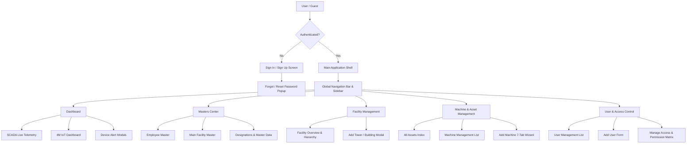

# Gmark IoT & 4M ERP System — Comprehensive Wireframe & UI/UX Field Blueprint
**Target Audience:** Engineering Interns, Frontend & Backend Developers, Product Managers  
**System Name:** Gmark IoT & 4M Asset & SCADA Management Platform  
**Version:** 2.4.0  

---

## 1. Executive Summary & Intern Onboarding Guide

Welcome to the **Gmark IoT & 4M Platform**! This application is an enterprise-grade IoT, SCADA, Facility, and Asset Management platform designed for real-time telemetry monitoring (pumps, fire panels, water pressure, electrical parameters) as well as full 4M (Man, Machine, Material, Method) enterprise operations.

### Key Modules Covered in this Blueprint:
1. **SignUp / SignIn & Authentication** (Auth & Security Flow)
2. **Dashboard (SCADA Telemetry & 4M IoT Operations)** (Live telemetry, device status, alert feeds)
3. **All Assets Management** (Asset indexing, location linking, specification tags, document repository)
4. **Masters Center** (Designations, Postal Codes, Code Sequences, Permission Schemas)
5. **Employee Master Management** (2-Step Employee Onboarding, Auto Credentials & Role Mapping)
6. **Main Facility & Sub-Facility Master Management** (Hierarchy Tree, GPS mapping, Auto Pincode Lookup)
7. **User Management & Role-Based Access Control (RBAC)** (Users, Role Builder, Granular Permission Matrix)
8. **Facility Management** (Society / Complex tree, Towers/Buildings, Flats & Hierarchy)
9. **Machine Management** (7-Tab Multi-Step Machine Builder, Spares, AMC/Warranty, Specs, IoT MAC ID Linkage)

---

## 2. System Navigation & Architecture Flowchart



---

## 3. Module Wireframes, Field Specifications & Modal UI Workflows

---

### Module 1: SignUp / SignIn & Auth Workflows

#### 1.1 Page Wireframe Layout

```
+-----------------------------------------------------------------------------------+
|  [LOGO] Gmark IoT System                        [ Help / Documentation ]          |
+-----------------------------------------------------------------------------------+
|                                                                                   |
|                   +-------------------------------------------+                   |
|                   |               Welcome Back                |                   |
|                   |    Enter your credentials to access       |                   |
|                   |                                           |                   |
|                   | Username / Email *                        |                   |
|                   | [ admin@gmark.com                       ] |                   |
|                   |                                           |                   |
|                   | Password *                                |                   |
|                   | [ **********                      ] (eye) |                   |
|                   |                                           |                   |
|                   | [x] Remember Me       [ Forgot Password? ]|                   |
|                   |                                           |                   |
|                   | [           Sign In Button             ]  |                   |
|                   |                                           |                   |
|                   | Don't have an account? [ Sign Up ]        |                   |
|                   +-------------------------------------------+                   |
+-----------------------------------------------------------------------------------+
```

#### 1.2 SignUp Page Wireframe

```
+-----------------------------------------------------------------------------------+
|  [LOGO] Register New Enterprise Account                                           |
+-----------------------------------------------------------------------------------+
|  Company Name *                GST Number *                                       |
|  [ Gmark Software Pvt Ltd    ] [ 27AAAAA0000A1Z5            ]                    |
|                                                                                   |
|  Admin Email *                 Mobile Number *                                    |
|  [ admin@gmark.com           ] [ 9876543210                 ]                    |
|                                                                                   |
|  Pincode                       City                           State               |
|  [ 411001                    ] [ Pune                       ] [ Maharashtra     ] |
|                                                                                   |
|  Password *                    Confirm Password *                                 |
|  [ **********          (eye) ] [ **********           (eye) ]                     |
|                                                                                   |
|  [                      Complete Registration                      ]              |
+-----------------------------------------------------------------------------------+
```

#### 1.3 Field Specifications & Validation

| Screen | Field Name | Input Type | DB Field Mapping | Required | Validation & Rules |
| :--- | :--- | :--- | :--- | :--- | :--- |
| **SignIn** | Username / Email | Text / Email | `User.username` / `User.email` | Yes | Valid email format or registered username |
| **SignIn** | Password | Password | `User.password` | Yes | Min 8 chars, hashed via bcrypt |
| **SignIn** | Remember Me | Checkbox | LocalStorage | No | Persists JWT refresh token |
| **SignUp** | Company Name | Text | `Registration.companyName` | Yes | 3-100 characters |
| **SignUp** | GST Number | Text | `Registration.gstNumber` | Yes | Standard 15-character GSTIN format |
| **SignUp** | Pincode | Text | `Registration.zipCode` | No | 6 digits; triggers auto-lookup for City & State |
| **SignUp** | City / State | Text | `Registration.city` / `state` | Auto/Manual | Populated automatically via `PostalCode` table |

#### 1.4 Modals & Popups
* **Forgot Password Modal / Drawer:**
  * *Inputs:* Email Address
  * *Actions:* "Send Reset Link" -> Triggers token generation email.
* **Reset Password Modal:**
  * *Inputs:* New Password, Confirm New Password.
  * *Rules:* Must contain Uppercase, Lowercase, Number, Special Character.

---

### Module 2: Dashboard (SCADA Telemetry & 4M IoT Operations)

#### 2.1 Dashboard Wireframe Layout

```
+-----------------------------------------------------------------------------------+
| [≡] Gmark SCADA & 4M Dashboard        [Facility: Main Plant v] [System Status: OK]|
+-----------------------------------------------------------------------------------+
| KPI Overview Cards:                                                               |
| +------------------+ +------------------+ +------------------+ +------------------+ |
| | Total Devices:12 | | Active Pumps:  8 | | System Press: 4.2| | Active Alerts: 2 | |
| +------------------+ +------------------+ +------------------+ +------------------+ |
|                                                                                   |
| Live Telemetry Telemetry Cards (SCADA / Fire Panel / Water Systems):             |
| +-----------------------------------------+ +-----------------------------------+ |
| | Pump Station 01 - Hydro-Pneumatic       | | Fire Panel Telemetry              | |
| | Motor 1: [ON]  (Current: 14.2A, 415V)   | | Jockey Pump: [AUTO / READY]       | |
| | Motor 2: [OFF] (Current: 0.0A,  415V)   | | Main Diesel Engine: [STANDBY]     | |
| | Discharge Pressure: [ 4.2 Bar ]         | | Header Pressure: [ 7.0 Bar ]      | |
| | Level Tank: [ 85% ]                     | | Alarm Status: [ NORMAL ]          | |
| | [ View Live Controls ] [ Hardware Logs ]| | [ Open Control Panel ]          | |
| +-----------------------------------------+ +-----------------------------------+ |
|                                                                                   |
| Live Alert Log Widget:                                                            |
| +-------------------------------------------------------------------------------+ |
| | Timestamp         | Device ID | Severity  | Message               | Action    | |
| | 2026-08-25 14:30  | DEV-102   | WARNING   | High Pressure Level   | [Acknowledge]|
| | 2026-08-25 14:10  | DEV-004   | CRITICAL  | Motor Overload Trip   | [Resolve] | |
| +-------------------------------------------------------------------------------+ |
+-----------------------------------------------------------------------------------+
```

#### 2.2 Dashboard Component & Popups

* **Password Protection Modal (Hardware Control Action):**
  * *Trigger:* User clicks "Start Pump", "Stop Pump", or toggles Manual Mode on live dashboard.
  * *Input:* 6-digit BMS Authorization PIN / User Password.
  * *Action:* On verification, publishes MQTT payload to Modbus register.
* **Alert Details & Resolution Popup:**
  * *Displays:* Device ID, Trigger Key, Alarm Type (CRITICAL / WARNING), Timestamp.
  * *Input:* Resolution notes.
  * *Actions:* Mark Acknowledged / Mark Resolved.

---

### Module 3: All Assets Management

#### 3.1 Page Wireframe Layout

```
+-----------------------------------------------------------------------------------+
| Asset Directory                                        [ + Add New Asset Button ] |
+-----------------------------------------------------------------------------------+
| Search: [ Search Asset Name / Code... ]   Filters: [ Facility v ] [ Category v ]  |
+-----------------------------------------------------------------------------------+
| Asset Code | Asset Name         | Category     | Facility Link    | Status | Action|
|------------|--------------------|--------------|------------------|--------|-------|
| AST-001    | Hydro Pump Assembly| Water System | Main Plant - B1  | ONLINE | [...] |
| AST-002    | Fire Diesel Engine | Safety       | Main Plant - Roof| ONLINE | [...] |
| AST-003    | Air Compressor 50HP| Utilities    | Sub-Facility 02  | OFF    | [...] |
+-----------------------------------------------------------------------------------+
```

#### 3.2 Add Asset & View Specs Modal

```
+-----------------------------------------------------------------------------------+
| Modal: Asset Specifications & Document Explorer                                   |
+-----------------------------------------------------------------------------------+
| Tabs: [ Details ] [ Custom Specs ] [ Linked Documents ] [ IoT Sensor MAC ]        |
|                                                                                   |
| Specification Fields:                                                             |
| +-------------------------------------------------------------------------------+ |
| | Field Title          | Field Type | Value          | Unit       | Action      | |
| | Operating Voltage    | Number     | 415            | V          | [ Delete ]  | |
| | Power Rating         | Number     | 15             | kW         | [ Delete ]  | |
| +-------------------------------------------------------------------------------+ |
| [ + Add Specification Field ]                                                     |
|                                                                                   |
| Linked Documents:                                                                 |
| [ Upload File ] [ Attach Link ] [ Add Note ]                                      |
+-----------------------------------------------------------------------------------+
```

---

### Module 4: Masters Management Center

#### 4.1 Master Center Architecture

The Masters module manages enterprise-wide reference data that populates dropdowns across the application:
1. **Designations Master** (Role titles & default access maps)
2. **Postal Codes Master** (India pincodes mapped to City/State)
3. **Code Sequences Master** (Auto-numbering rules for Employee Codes, Asset Codes, Facility Codes)

#### 4.2 Designation & Permissions Drawer

```
+-----------------------------------------------------------------------------------+
| Drawer: Create / Edit Designation                                                 |
+-----------------------------------------------------------------------------------+
| Designation Name * : [ Senior Electrical Engineer                               ] |
| Active Status      : (o) Active   ( ) Inactive                                    |
|                                                                                   |
| Module Access Matrix:                                                             |
| Module Name        | View | Create | Edit | Delete | Import | Export | Print    |
| -------------------|------|--------|------|--------|--------|--------|-------   |
| SCADA Dashboard    |  [x] |   [ ]  |  [x] |   [ ]  |   [ ]  |   [x]  |  [x]     |
| Employee Master    |  [x] |   [x]  |  [x] |   [ ]  |   [x]  |   [x]  |  [x]     |
| Facility Master    |  [x] |   [x]  |  [x] |   [x]  |   [x]  |   [x]  |  [x]     |
| Machine Management |  [x] |   [x]  |  [x] |   [ ]  |   [ ]  |   [x]  |  [ ]     |
|                                                                                   |
| [ Cancel ]                                                    [ Save Designation ]|
+-----------------------------------------------------------------------------------+
```

---

### Module 5: Employee Master Management

#### 5.1 Page Wireframe Layout & 2-Step Form Wizard

```
Step 1: Personal & Employment Details
+-----------------------------------------------------------------------------------+
| New Employee Onboarding                                         [ Step 1 of 2 ]   |
+-----------------------------------------------------------------------------------+
| Employee Code * (Auto)      Full Name *                 Mobile Number * (10 Dig)|
| [ EMP004                  ] [ John Doe                ] [ 9876543210            ] |
|                                                                                   |
| Official Email *            Personal Email              Date of Joining *         |
| [ john@gmark.com          ] [ john.personal@gmail.com ] [ 2026-08-01            ] |
|                                                                                   |
| Date of Birth *             Department *                Designation *             |
| [ 1995-04-15              ] [ Engineering           v ] [ System Admin        v ] |
|                                                         [+ Add New Designation]   |
|                                                                                   |
| Salary Payout (Monthly)                                                           |
| [ 65000                   ] -> Calculates: ₹ 7,80,000 / year                      |
|                                                                                   |
|                                                                 [ Next Step -> ]  |
+-----------------------------------------------------------------------------------+

Step 2: User Login Account Credentials
+-----------------------------------------------------------------------------------+
| User Account Provisioning                                       [ Step 2 of 2 ]   |
+-----------------------------------------------------------------------------------+
| [x] Create a login account for this employee                                      |
|                                                                                   |
| Generated Username *        Password *                                            |
| [ john.doe                ] [ K8#mP!9z               ] (eye) [ Generate ]     |
|                                                                                   |
| System Role Auto-Mapped: [ OPERATOR / ADMIN ]                                     |
|                                                                                   |
| [ <- Back ]                                                    [ Save Employee ]  |
+-----------------------------------------------------------------------------------+
```

#### 5.2 View Employee Profile Drawer Popup

```
+-----------------------------------------------------------------------------------+
| Profile Card: John Doe                                              [ Edit Profile]|
+-----------------------------------------------------------------------------------+
| ( User Avatar )  John Doe                                                         |
|                  Senior Systems Engineer • Engineering Department                 |
|-----------------------------------------------------------------------------------|
| Contact Info                        | Work Details                                |
| Mobile: +91 9876543210              | Employee Code: EMP004                       |
| Official: john@gmark.com            | Date of Joining: 01 Aug 2026                |
| Personal: john.personal@gmail.com   | Monthly Salary: ₹ 65,000                    |
+-----------------------------------------------------------------------------------+
```

#### 5.3 Field Specifications

| Field Name | Type | DB Column | Validation & Rules |
| :--- | :--- | :--- | :--- |
| Employee Code | Text | `Employee.employeeCode` | Auto-generated via `/employees/next-code` API |
| Full Name | Text | `Employee.fullName` | Min 2 chars, letters & spaces |
| Mobile Number | Text | `Employee.mobileNumber` | Exactly 10 digits, numeric validation |
| Official Email | Email | `Employee.officialEmail` | Unique email check |
| Date of Joining | Date | `Employee.dateOfJoining` | Valid past or current date |
| Department | Select | `Employee.department` | Options: Engineering, HR, Finance, Operations |
| Designation | Select | `Employee.designation` | Fetched from `Designation` model. Includes "+ Add new Designation" redirect action |
| Salary Payout | Number | `Employee.salaryPayout` | Monthly figure; auto-calculates yearly package |
| Username | Text | `User.username` | Auto-formatted as `firstname.lastname` |
| Password | Password | `User.password` | Auto-generated option or custom min 8 char strong pass |

---

### Module 6: Main Facility & Sub-Facility Master Management

#### 6.1 Architecture & Hierarchy Wireframe

```
Hierarchy Structure:
Main Facility (Company / Site)
  ├── Child Facility 1 (Building / Factory Unit)
  │     ├── Machine A
  │     └── Machine B
  └── Child Facility 2 (Warehouse / Utility Block)
```

```
+-----------------------------------------------------------------------------------+
| Main Facility Master                                   [ + Add Main Facility ]    |
+-----------------------------------------------------------------------------------+
| Code    | Main Facility Name | Category    | Facility Head | City     | Actions   |
|---------|--------------------+-------------|---------------+----------|-----------|
| MFAC001 | Pune HQ Campus     | Commercial  | Rajesh Sharma | Pune     | [View/Edit]|
| MFAC002 | Chakan Plant 01    | Industrial  | Anil Patil    | Chakan   | [View/Edit]|
+-----------------------------------------------------------------------------------+
```

#### 6.2 Add Main Facility & Sub-Facility Form Fields

```
+-----------------------------------------------------------------------------------+
| Add / Edit Main Facility                                                          |
+-----------------------------------------------------------------------------------+
| Facility Code *             Facility Name *             Facility Head *           |
| [ MFAC003                 ] [ Nashik Manufacturing    ] [ Sunita Verma        v ] |
|                                                                                   |
| GST Number                  Category *                  Sub-Category              |
| [ 27ABCDE1234F1Z5         ] [ Industrial            v ] [ Plant 01            v ] |
|                                                                                   |
| Postal Code                 State                       City                      |
| [ 422007                  ] [ Maharashtra             ] [ Nashik                ] |
| (Auto-populates State & City from PostalCode DB)                                  |
|                                                                                   |
| Latitude                    Longitude                                             |
| [ 19.9975                 ] [ 73.7898                 ] [ Pick from Map ]       |
|                                                                                   |
| Full Address                                                                      |
| [ Plot 45, MIDC Ambad, Nashik, Maharashtra 422007                               ] |
|                                                                                   |
| [ Cancel ]                                                     [ Save Facility ]  |
+-----------------------------------------------------------------------------------+
```

#### 6.3 Sub-Facility (Child Facility) Modal

When adding a Sub-Facility:
* **Parent Main Facility:** Picked from dropdown tree.
* **Is Location Part:** Toggle (Yes/No). If Yes, inherits parent latitude/longitude.
* **Facility Code:** Auto-generated sequence (`FAC001`, `FAC002`).

---

### Module 7: User Management & Role Management (RBAC)

#### 7.1 Page Wireframe Layout

```
+-----------------------------------------------------------------------------------+
| User Management Center             [ Manage Access Roles ]  [ + Add New User ]    |
+-----------------------------------------------------------------------------------+
| Search: [ Search users... ]         Filter Role: [ All Roles v ]  Status: [ Active v]|
+-----------------------------------------------------------------------------------+
| User Name  | Email             | Mobile      | System Role    | Status | Actions  |
|------------|-------------------|-------------|----------------|--------|----------|
| admin      | admin@gmark.com   | 9876543210  | SUPER_ADMIN    | ACTIVE | [Edit/Key]|
| operator01 | op1@gmark.com     | 9812345678  | OPERATOR       | ACTIVE | [Edit/Key]|
| viewer_user| view@gmark.com    | 9765432109  | VIEWER         | ACTIVE | [Edit/Key]|
+-----------------------------------------------------------------------------------+
```

#### 7.2 User Creation & Permission Assignment Form

```
+-----------------------------------------------------------------------------------+
| Add User Account                                                                  |
+-----------------------------------------------------------------------------------+
| First Name *          Last Name *           Email Address *                       |
| [ Rahul             ] [ Kulkarni          ] [ rahul.k@gmark.com                 ] |
|                                                                                   |
| Username *            Password *            Role Assignment *                     |
| [ rahul.k           ] [ ********   (eye)  ] [ BUILDING_ADMIN                    v ] |
|                                                                                   |
| Link to Employee      Link Main Facility    Link Assigned Buildings               |
| [ EMP004 - Rahul  v ] [ Pune HQ Campus   v ] [ [x] Building A  [x] Building B     ] |
|                                                                                   |
| Granular Permission Overrides (Optional):                                         |
| [ View Permission Matrix Modal ]                                                 |
|                                                                                   |
| [ Cancel ]                                                       [ Create User ]  |
+-----------------------------------------------------------------------------------+
```

#### 7.3 Role Permissions Matrix Grid (Modal)

```
+-----------------------------------------------------------------------------------+
| Granular Access Control Matrix — Role: BUILDING_ADMIN                             |
+-----------------------------------------------------------------------------------+
| Permission Module | View | Create | Edit | Delete | Import | Export | Hardware Control |
|-------------------|------|--------|------|--------|--------|--------|------------------|
| Dashboard / SCADA |  [x] |   [ ]  |  [x] |   [ ]  |   [ ]  |   [x]  |       [x]        |
| Facility Master   |  [x] |   [x]  |  [x] |   [ ]  |   [ ]  |   [x]  |       N/A        |
| Machine Control   |  [x] |   [x]  |  [x] |   [x]  |   [x]  |   [x]  |       [x]        |
| User Management   |  [x] |   [ ]  |  [ ] |   [ ]  |   [ ]  |   [ ]  |       N/A        |
+-----------------------------------------------------------------------------------+
```

---

### Module 8: Facility Management (Societies, Towers & Buildings)

#### 8.1 Page Layout & Hierarchy Tree

```
+-----------------------------------------------------------------------------------+
| Facility & Infrastructure Hierarchy                                               |
+-----------------------------------------------------------------------------------+
| [ + Add Tower / Building ]   [ Society Overview ]   [ Facility Asset Map ]        |
|                                                                                   |
| Hierarchy Tree View:                                                              |
| 🏢 Main Facility: Pune Technology Park                                             |
|    ├── 🏙️ Building Alpha                                                          |
|    │     ├── ⚡ Machine: Booster Pump System #1 (DEV-101)                          |
|    │     └── ⚡ Machine: Fire Pump Panel (DEV-102)                                 |
|    └── 🏙️ Building Beta                                                           |
|          └── ⚡ Machine: Hydro Pneumatic System (DEV-103)                          |
+-----------------------------------------------------------------------------------+
```

#### 8.2 Add Tower / Building Popup Modal

```
+-----------------------------------------------------------------------------------+
| Modal: Add Tower / Building                                                       |
+-----------------------------------------------------------------------------------+
| Parent Main Facility * : [ Pune Technology Park                                 v ]|
| Building / Tower Name *: [ Building Alpha                                         ]|
| Floor Count            : [ 12                                                     ]|
| Total Flats / Units    : [ 96                                                     ]|
| Info Tag               : [ 12F - 96 Flats                                         ]|
|                                                                                   |
| [ Cancel ]                                                       [ Add Building ] |
+-----------------------------------------------------------------------------------+
```

---

### Module 9: Machine Management (7-Tab Multi-Step Wizard)

Machine Management is the core IoT asset builder. It features a 3-step navigation flow culminating in a 7-tab detailed wizard.

#### 9.1 Multi-Step Wizard Overview

* **Step 1:** Facility & Company Selection
* **Step 2:** Basic Machine Information (Name, Code, Make, Model, Category)
* **Step 3:** Detailed Tabbed Configuration (General, Specs, Spares, AMC, Purchase, Documents, IOT)

#### 9.2 Step 3 — Tabbed Interface Wireframe Layout

```
+-----------------------------------------------------------------------------------+
| Machine Builder — Step 3                                                          |
+-----------------------------------------------------------------------------------+
| [ General ] [ Specification ] [ Spares ] [ AMC ] [ Purchase ] [ Documents ] [ IOT ]|
|-----------------------------------------------------------------------------------|
| (Active Tab: General)                                                             |
|                                                                                   |
| Location Hierarchy Selection:                                                     |
| (o) This Machine is a part of parent machine:  [ Main Booster Assembly 01      v ]|
| ( ) This Machine is located directly at location: [ Facility - Chakan Unit     v ]|
|                                                                                   |
| GPS & Cost Center Fields:                                                         |
| Latitude *        Longitude *       Asset Code *      Cost Center *               |
| [ 18.5204       ] [ 73.8567       ] [ AST-MC-009   ] [ CC-ENG-2026            ] |
|                                                                                   |
| Department Head *                   Machine Owner *                               |
| [ Engg Manager - Rajesh Sharma  v ] [ Maintenance Lead - Anil Patil             v ] |
|                                                                                   |
| Notes & Operational Guidelines:                                                   |
| [ Primary water supply pump for Commercial Block A. Inspection every 30 days.   ] |
+-----------------------------------------------------------------------------------+
```

#### 9.3 Tab 2: Specifications Modal

```
+-----------------------------------------------------------------------------------+
| Modal: Add Specification Field                                                    |
+-----------------------------------------------------------------------------------+
| Asset: Domestic Terrace Booster System                                            |
|                                                                                   |
| Field Title *  : [ Motor Horsepower                                             ] |
| Input Type *   : [ Number                                                     v ] |
| Field Data *   : [ 15                                                           ] |
| Field Unit *   : [ HP                                                         v ] |
|                                                                                   |
| [ Cancel ]                                                    [ Save Spec Field ] |
+-----------------------------------------------------------------------------------+
```

#### 9.4 Tab 3 & 4: Spares, AMC & Warranties Management

```
+-----------------------------------------------------------------------------------+
| Tab: AMC & Warranties Management                             [ + Add AMC Record ] |
+-----------------------------------------------------------------------------------+
| Toggle: [ (x) AMC Contracts ]   [ ( ) Warranties ]                                |
|                                                                                   |
| Provider Name   | Start Date | End Date   | Certificate No. | Usage     | Action  |
|-----------------|------------|------------|-----------------|-----------|---------|
| Grundfos Services| 2026-01-01 | 2027-01-01 | AMC-2026-9901   | 1 Year    | [Delete]|
+-----------------------------------------------------------------------------------+
```

#### 9.5 Tab 6: Documents Explorer Modal

```
+-----------------------------------------------------------------------------------+
| Tab: Documents Repository                                       [ + Upload Dropdownv]|
+-----------------------------------------------------------------------------------+
| Upload Menu Options:                                                              |
|   ├── File  (Upload PDF, PNG, JPG nameplate / manual)                             |
|   ├── Link  (Attach external Web URL / Cloud link)                                |
|   └── Note  (Write plain text maintenance log entry)                              |
|                                                                                   |
| Name             | Doc Type | Document Content / Link             | Actions       |
|------------------|----------|-------------------------------------|---------------|
| Pump Manual PDF  | File     | [ View File: pump_manual.pdf ]      | [ Delete ]    |
| Wiring Diagram   | Link     | [ https://drive.google.com/... ]     | [ Delete ]    |
+-----------------------------------------------------------------------------------+
```

#### 9.6 Tab 7: IoT System & MAC ID Linking Modal

```
+-----------------------------------------------------------------------------------+
| Tab: IoT Edge Sensor & MAC ID Configuration                                      |
+-----------------------------------------------------------------------------------+
| System MAC ID: [ 24:D7:EB:11:A4:9C ]                       [ Update System MAC ]  |
|                                                                                   |
| IoT Device Connection Status:                                                     |
| [⚡ LIVE DATA STREAM ACTIVE]                                                      |
| Last Heartbeat: 2 Seconds ago                                                     |
| Telemetry Topic: gmark/iot/24D7EB11A49C/telemetry                                 |
+-----------------------------------------------------------------------------------+
```

#### 9.7 Complete Machine Data Field Dictionary

| Tab | Field Label | Input Type | DB Field | Required | Notes |
| :--- | :--- | :--- | :--- | :--- | :--- |
| **Step 1** | Company | Hierarchy Dropdown | `Machine.company` | Yes | Selects Main Facility |
| **Step 1** | Facility | Hierarchy Dropdown | `Machine.facilityId` | Yes | Selects Sub-Facility / Building |
| **Step 1** | Maintenance Head | Custom Select | `Machine.maintenanceHead` | No | Links to Employee |
| **Step 2** | Machine Name | Text | `Machine.name` | Yes | Asset title |
| **Step 2** | Machine Code | Text | `Machine.machineCode` | Yes | Unique inventory identifier |
| **Step 2** | Status | Select | `Machine.status` | Yes | Options: `Online`, `Offline` |
| **Step 2** | Serial Number | Text | `Machine.serialNumber` | Yes | Manufacturer serial no. |
| **Step 2** | Make & Model | Custom Select | `Machine.make`, `modelNumber` | Yes | Supports custom entries |
| **General** | Is Location Part | Radio Button | `Machine.isLocationPart` | Yes | Toggles parent machine inheritance |
| **General** | Parent Machine | Hierarchy Select | `Machine.parentMachineId` | Conditional | Enabled if `isLocationPart` is true |
| **General** | Latitude / Longitude | Text | `Machine.latitude`, `longitude` | Yes | GPS coordinates |
| **General** | Asset Code | Text | `Machine.assetCode` | Yes | Financial asset tagging |
| **General** | Cost Center | Text | `Machine.costCenter` | Yes | Financial accounting code |
| **General** | Head of Dept | Custom Select | `Machine.headOfDepartment` | Yes | Employee designation link |
| **General** | Machine Owner | Custom Select | `Machine.machineOwner` | Yes | Employee designation link |
| **Specs** | Upload Nameplate | File Upload | `MachineDocument` | No | Image/PDF upload |
| **Specs** | Custom Spec Title | Text | `MachineSpecification.title` | Modal | e.g. "Flow Rate" |
| **Specs** | Input Type & Unit | Select | `MachineSpecification.inputType/unit` | Modal | Options: Text, Number, Boolean / kW, V, mm, kg |
| **IoT** | System MAC ID | Text / Modal | `Machine.deviceId` | Yes | Unique Hardware MAC (e.g. `24:D7:EB:11:A4:9C`) |

---

## 4. API Endpoint Cheat Sheet for Developers & Interns

To assist interns during frontend & backend implementation, here is the RESTful API service map:

| Module | Endpoint | HTTP Method | Description |
| :--- | :--- | :--- | :--- |
| **Auth** | `/auth/login` | POST | Authenticates user & returns JWT tokens |
| **Auth** | `/auth/signup` | POST | Registers new company & admin user |
| **Employee** | `/employees` | GET / POST | List all employees / Create new employee |
| **Employee** | `/employees/next-code` | GET | Auto-generates next code sequence (`EMPxxx`) |
| **Employee** | `/employees/:id` | GET / PATCH | View or update employee profile |
| **Facility** | `/main-facilities` | GET / POST | Main facility CRUD |
| **Facility** | `/facilities` | GET / POST | Sub-facility CRUD |
| **User** | `/users` | GET / POST | User account management |
| **Roles** | `/designations` | GET / POST | Roles & permissions schema |
| **Machine** | `/machines` | GET / POST | Fetch machine list or create machine |
| **Machine** | `/machines/:id/specifications`| POST | Append specification key-values |
| **Machine** | `/machines/:id/documents`| POST | Upload document file/link/note |
| **SCADA** | `/scada/devices` | GET | Fetch live IoT telemetry snapshots |

---

## 5. Intern Onboarding Action Checklist

When starting development or testing on the Gmark IoT project, verify your environment with this checklist:

- [ ] **Step 1:** Clone the repository and examine `backend/prisma/schema.prisma`.
- [ ] **Step 2:** Ensure your local database is seeded with `npm run seed` in `backend`.
- [ ] **Step 3:** Run frontend (`npm run dev`) and test authentication via `admin` user.
- [ ] **Step 4:** Navigate to **Employee Master** and test the 2-step wizard (Verify auto-generation of Employee Code and password generator).
- [ ] **Step 5:** Navigate to **Machine Management** and complete a full 7-tab Machine Creation flow, attaching a test MAC ID (`AA:BB:CC:DD:EE:FF`).
- [ ] **Step 6:** Check **SCADA Dashboard** for real-time telemetry card rendering and alert status toggles.

---
*End of Blueprint Document. Prepared for Gmark Software Pvt Ltd Intern Onboarding.*
