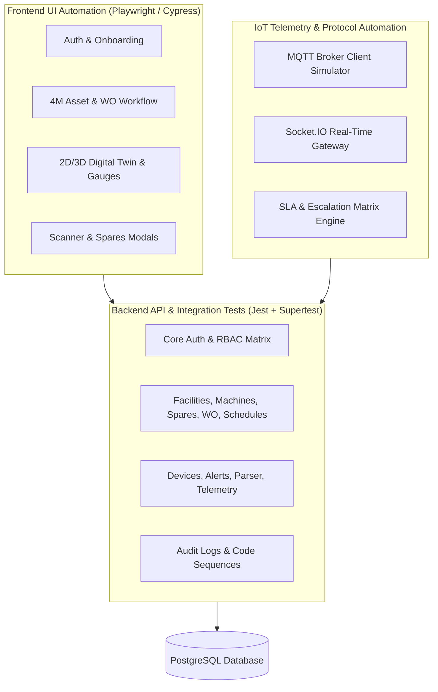

# Gmark IoT & CMMS - Master Automation Test Cases Specification (Entire Project)

## 1. Executive Summary & Test Automation Framework

This document outlines the **complete, end-to-end automation test suite** for the entire **Gmark IoT & CMMS Platform**, covering all 26 functional domains across backend microservices, IoT ingestion pipelines, database integrity, access control, and frontend browser user journeys.



---

## 2. Test Execution Quick Reference

```bash
# Execute entire Backend Automated E2E Test Suite (All 7 Suites, 44+ Tests)
cd backend
npm run test:e2e

# Run with test coverage analysis
npm run test:e2e -- --coverage
```

---

## 3. Comprehensive Automation Test Cases Matrix (All Modules)

### Part I: Core Platform, Auth, RBAC & Security

| Test ID | Module / Feature | Test Objective & Automation Action | Test Payload & Conditions | Expected Output & Assertions | Priority |
| :--- | :--- | :--- | :--- | :--- | :--- |
| **TC-AUTH-001** | Auth - Login | Verify authentication with valid credentials (`POST /auth/login`) | `{"username": "superadmin", "password": "ValidPassword"}` | HTTP 200, returns JWT `accessToken`, `refreshToken`, user object with `role: SUPER_ADMIN` | **P0** |
| **TC-AUTH-002** | Auth - Login | Verify rejection of invalid password (`POST /auth/login`) | `{"username": "superadmin", "password": "WrongPassword999"}` | HTTP 401 Unauthorized, message: `Invalid credentials` | **P0** |
| **TC-AUTH-003** | Auth - Validation | Reject empty credentials payload (`POST /auth/login`) | `{}` | HTTP 400 Bad Request, validation pipes reject missing fields | **P1** |
| **TC-AUTH-004** | Auth - Token Refresh | Verify token renewal using valid refresh token (`POST /auth/refresh`) | `{"refreshToken": "<valid_jwt_refresh>"}` | HTTP 200, returns newly signed `accessToken` | **P0** |
| **TC-AUTH-005** | Auth - Guard | Block unauthenticated requests on protected endpoints (`GET /auth/me`) | No `Authorization` header provided | HTTP 401 Unauthorized | **P0** |
| **TC-AUTH-006** | Auth - Profile | Fetch resolved user profile & permissions (`GET /auth/me`) | Bearer token for User ID 29 | HTTP 200, returns `user.id: 29`, `user.email`, and full permissions array | **P0** |
| **TC-AUTH-007** | Auth - Module Access | Update tenant module subscription (`PATCH /auth/module-access`) | `{"moduleAccess": "BOTH"}` | HTTP 200, updates access level across `CMMS`, `IOT`, or `BOTH` | **P1** |
| **TC-AUTH-008** | RBAC - Boundary | Block Operator role from accessing Admin-only machine deletion | Operator JWT Bearer token | HTTP 403 Forbidden | **P0** |
| **TC-AUTH-009** | Core - Audit Log | Automatically persist audit trail record upon user actions | Clean audit state; perform login & WO creation | Record written to `AuditLog` table with `userId`, `module: 'AUTH'`, client IP, timestamp | **P1** |
| **TC-AUTH-010** | Core - Designation | Query designation permissions matrix (`GET /designations`) | Authenticated Super Admin | HTTP 200, returns designations with granular CRUDIP flags (`canView`, `canCreate`, `canEdit`, `canDelete`, `canImport`, `canExport`, `canPrint`) | **P1** |

---

### Part II: 4M Hierarchy (Main Facility, Facility, Society, Building, Postal Codes)

| Test ID | Module / Feature | Test Objective & Automation Action | Test Payload & Conditions | Expected Output & Assertions | Priority |
| :--- | :--- | :--- | :--- | :--- | :--- |
| **TC-FAC-001** | Main Facilities | Fetch all main facilities (`GET /main-facilities`) | Authenticated token | HTTP 200, returns list of MainFacility entities with GST, Category & Head | **P1** |
| **TC-FAC-002** | Facilities | Auto-generate next facility code (`GET /facilities/next-code`) | Authenticated token | HTTP 200, returns sequential string formatted as `FAC-YYYY-XXXX` | **P1** |
| **TC-FAC-003** | Facilities | Create child facility with parent hierarchy (`POST /facilities`) | `{"facilityName": "Booster Pump Room", "parentFacilityId": 1, "mainFacilityId": 1}` | HTTP 201 Created, `parentFacilityId` linked correctly | **P0** |
| **TC-FAC-004** | Facilities | Move facility under new parent (`PATCH /facilities/:id/move`) | `{"targetType": "facility", "targetId": 2}` | HTTP 200, facility hierarchy tree updated without orphan nodes | **P2** |
| **TC-SOC-001** | Societies & Buildings | Fetch societies catalog with buildings (`GET /societies`) | Authenticated token | HTTP 200, returns societies array with nested building flat counts | **P1** |
| **TC-BLD-001** | Buildings | Create building linked to society (`POST /buildings`) | `{"name": "Tower C", "societyId": 1, "info": "14F - 56 flats"}` | HTTP 201 Created, building created under society | **P1** |
| **TC-PIN-001** | Postal Codes | Auto-lookup city and state by postal code (`GET /postal-codes/:pincode`) | `pincode = "411018"` | HTTP 200, returns `{"city": "Pune", "state": "Maharashtra", "country": "India"}` | **P2** |

---

### Part III: 4M Asset & Machine Master Management

| Test ID | Module / Feature | Test Objective & Automation Action | Test Payload & Conditions | Expected Output & Assertions | Priority |
| :--- | :--- | :--- | :--- | :--- | :--- |
| **TC-MCH-001** | Machines - Preview | Retrieve next auto-generated machine code preview (`GET /machines/next-machine-code`) | Authenticated token | HTTP 200, returns preview object matching code sequence | **P1** |
| **TC-MCH-002** | Machines - Preview | Retrieve next auto-generated asset code preview (`GET /machines/next-asset-code`) | Authenticated token | HTTP 200, returns preview object for Asset Code | **P1** |
| **TC-MCH-003** | Machines - Create | Create complete machine asset with specs & checkpoints (`POST /machines`) | `{"name": "Booster Pump #1", "machineCode": "MCH-2026-001", "machineType": "HYPN", "specifications": [...], "checkpoints": [...]}` | HTTP 201 Created, machine created with linked specifications and maintenance checkpoints | **P0** |
| **TC-MCH-004** | Machines - Retrieve | Fetch machine details by ID with specifications (`GET /machines/:id`) | Machine ID | HTTP 200, returns machine entity with all attached specs, documents & checkpoints | **P0** |
| **TC-MCH-005** | Machines - Update | Update machine details & operating notes (`PUT /machines/:id`) | `{"notes": "Updated bearing maintenance remarks"}` | HTTP 200, notes field updated | **P1** |
| **TC-MCH-006** | Machines - QR Lookup | Public machine lookup via barcode/QR code (`GET /public/machines/lookup/:codeOrId`) | Machine Code (No Auth required) | HTTP 200, returns machine metadata, facility name, and active inspection checkpoints | **P0** |
| **TC-MCH-007** | Machine Checkpoints | Add checkpoint standard threshold (`POST /machines/:id/checkpoints`) | `{"title": "Check Motor Surface Temperature", "checkpointType": "ELECTRICAL", "standardValue": "< 70 C", "frequency": "DAILY"}` | HTTP 201, checkpoint attached to machine | **P1** |

---

### Part IV: 4M Work Orders (Full Lifecycle, 3-Tier Approval & Escalation)

| Test ID | Module / Feature | Test Objective & Automation Action | Test Payload & Conditions | Expected Output & Assertions | Priority |
| :--- | :--- | :--- | :--- | :--- | :--- |
| **TC-WO-001** | Work Orders - Validation | Reject creation when machine ID is missing (`POST /work-orders`) | `{"problemDescription": "Pump noise"}` | HTTP 400 Bad Request: `Machine ID is mandatory` | **P0** |
| **TC-WO-002** | Work Orders - Validation | Reject creation when problem description is missing (`POST /work-orders`) | `{"machineId": 1}` | HTTP 400 Bad Request: `Problem Description is mandatory` | **P0** |
| **TC-WO-003** | Work Orders - Create | Successfully create manual work order (`POST /work-orders`) | `{"machineId": 1, "problemDescription": "Low output pressure on Header Line 2", "priority": "HIGH", "triggerType": "MANUAL"}` | HTTP 201, `woNumber` matches `WO-YYYY-XXXX`, `status: 'PENDING_APPROVAL'` | **P0** |
| **TC-WO-004** | Work Orders - List | Retrieve work orders list with tab filtering (`GET /work-orders?tab=PENDING`) | Authenticated token | HTTP 200, returns array filtered strictly by status `PENDING_APPROVAL` | **P0** |
| **TC-WO-005** | Work Orders - Media | Multi-part media upload for proof of work (`POST /work-orders/upload-media`) | Multipart Form-Data (Image / Video up to 50MB) | HTTP 201, returns uploaded media array with `/uploads/work-orders/*` file URLs | **P1** |
| **TC-WO-006** | Work Orders - Approve | Maintenance manager approve work order & assign technician (`POST /work-orders/:id/approve`) | `{"technicianId": 12, "estimatedStartDate": "2026-10-18T10:00:00Z", "remarks": "Approved"}` | HTTP 201, `status: 'APPROVED'`, `assignedTechnicianId: 12`, `approvedById` populated | **P0** |
| **TC-WO-007** | Work Orders - Reject | Reject work order with mandatory rejection reason (`POST /work-orders/:id/reject`) | `{"rejectionReason": "Work order duplicated with WO-2026-0004"}` | HTTP 201, `status: 'REJECTED'`, `rejectionReason` stored, `rejectedAt` timestamp set | **P1** |
| **TC-WO-008** | Work Orders - Revision | Technician request extension / revision (`POST /work-orders/:id/request-revision`) | `{"reason": "Custom gasket procurement lead time", "proposedEstEndDate": "2026-10-24"}` | HTTP 201, `status: 'REVISION_REQUESTED'`, revision record generated | **P1** |
| **TC-WO-009** | Work Orders - Complete | Complete work order with spare parts allocation (`POST /work-orders/:id/complete`) | `{"completionNotes": "Overhauled impellers", "sparePartsUsed": [{"sparePartId": 1, "partName": "Seal", "quantity": 2, "unitCost": 500}]}` | HTTP 201, `status: 'COMPLETED'`, `totalCost: 1000` recorded, spares inventory decremented | **P0** |
| **TC-WO-010** | Work Orders - Close | Manager close completed work order (`POST /work-orders/:id/close`) | Work order in `COMPLETED` status | HTTP 201, `status: 'CLOSED'`, `closedAt` populated | **P0** |
| **TC-WO-011** | Work Orders - Level 3 | Plant Head approve Level 3 breakdown work order (`POST /work-orders/:id/level3-approve`) | `{"technicianId": 10, "remarks": "Authorized plant breakdown"}` | HTTP 201, `level3ApprovedAt` populated, `level3ApprovedById` set | **P1** |
| **TC-WO-012** | Work Orders - SLA Job | Automated SLA check for unapproved work orders (`GET /work-orders/check-escalation`) | Scheduled execution | HTTP 200, flags overdue work orders with `isEscalated: true` and notifies Head | **P2** |
| **TC-WO-013** | Work Orders - Metrics | Fetch historical metrics by category (`GET /work-orders/metrics/historical`) | Authenticated token | HTTP 200, returns counts broken down into Preventive, Predictive, Condition & Breakdown | **P2** |

---

### Part V: 4M Maintenance Schedules & Preventive Automation

| Test ID | Module / Feature | Test Objective & Automation Action | Test Payload & Conditions | Expected Output & Assertions | Priority |
| :--- | :--- | :--- | :--- | :--- | :--- |
| **TC-SCH-001** | Schedules - Auth | Enforce authentication on schedule endpoints (`GET /schedules`) | Header omitted | HTTP 401 Unauthorized | **P0** |
| **TC-SCH-002** | Schedules - List | Fetch schedules list when authenticated (`GET /schedules`) | Authenticated token | HTTP 200, returns array of active maintenance schedules | **P0** |
| **TC-SCH-003** | Schedules - Validation | Reject schedule creation when machineId is missing (`POST /schedules`) | `{"frequency": "MONTHLY", "scheduleType": "PREVENTIVE"}` | HTTP 400 Bad Request: `Machine association is required` | **P0** |
| **TC-SCH-004** | Schedules - Create | Create schedule with tasks & fallback spare IDs (`POST /schedules`) | `{"machineId": 1, "frequency": "MONTHLY", "scheduleType": "PREVENTIVE", "startDate": "2026-10-18", "prePlanToleranceDays": 2, "postPlanToleranceDays": 2, "tasks": [...], "spares": [...]}` | HTTP 201 Created, `scheduleCode` matches `SCH-YYYY-XXXX`, foreign keys safely handled | **P0** |
| **TC-SCH-005** | Schedules - Retrieve | Fetch schedule details with tasks and spares (`GET /schedules/:id`) | Schedule ID | HTTP 200, returns schedule with tasks and spares relations | **P1** |
| **TC-SCH-006** | Schedules - Update | Update tolerance days and notes (`PUT /schedules/:id`) | `{"priority": "CRITICAL", "notes": "Updated tolerance"}` | HTTP 200, reflects updated fields | **P1** |
| **TC-SCH-007** | Schedules - Trigger WO | Trigger Work Order generation on demand (`POST /schedules/:id/trigger-wo`) | Schedule ID | HTTP 201, generates Work Order with `triggerType: 'SCHEDULED'` and `notificationDispatched: true` | **P0** |
| **TC-SCH-008** | Schedules - Delete | Delete schedule with cascading task cleanup (`DELETE /schedules/:id`) | Schedule ID | HTTP 200 `success: true`, related schedule tasks & spares safely deleted | **P1** |

---

### Part VI: 4M Spare Parts Master & Suppliers

| Test ID | Module / Feature | Test Objective & Automation Action | Test Payload & Conditions | Expected Output & Assertions | Priority |
| :--- | :--- | :--- | :--- | :--- | :--- |
| **TC-SPR-001** | Spares - Catalog | Fetch spare parts catalog for current tenant (`GET /spare-parts`) | Authenticated token | HTTP 200, returns array of spare parts filtered by tenant `adminId` | **P0** |
| **TC-SPR-002** | Spares - Stock Update | Update inventory quantity and storage bin location (`PUT /spare-parts/:id`) | `{"stockQuantity": 75, "location": "Bin E2E-99"}` | HTTP 200, `stockQuantity: 75`, `location: "Bin E2E-99"` updated in DB | **P0** |
| **TC-SPR-003** | Spares - Deduct | Automatic stock decrement when work order completes | Completed WO allocating 5 units of Part ID 1 | `stockQuantity` decrements by 5 units in PostgreSQL | **P0** |
| **TC-SUP-001** | Suppliers - Next Code | Fetch next auto-generated supplier code (`GET /suppliers/next-code`) | Authenticated token | HTTP 200, returns sequential supplier code preview | **P1** |
| **TC-SUP-002** | Suppliers - Create | Create new supplier record (`POST /suppliers`) | `{"name": "Apex Industrial Spares", "email": "sales@apex.com", "phone": "9876543210", "city": "Pune", "country": "India"}` | HTTP 201 Created, supplier created with valid email and phone format | **P1** |
| **TC-SUP-003** | Suppliers - Search | Search suppliers by keyword (`GET /suppliers?search=Apex`) | Keyword query string | HTTP 200, returns array containing matching supplier record | **P1** |
| **TC-SUP-004** | Suppliers - Delete | Delete supplier by ID (`DELETE /suppliers/:id`) | Supplier ID | HTTP 200, supplier removed | **P2** |

---

### Part VII: 4M Employees & HR Hierarchy

| Test ID | Module / Feature | Test Objective & Automation Action | Test Payload & Conditions | Expected Output & Assertions | Priority |
| :--- | :--- | :--- | :--- | :--- | :--- |
| **TC-EMP-001** | Employees - List | Retrieve employees list (`GET /employees`) | Authenticated token | HTTP 200, returns array of employee profiles | **P1** |
| **TC-EMP-002** | Employees - Salary Check | Reject employee creation with negative salary (`POST /employees`) | `{"salaryPayout": -5000, "fullName": "Test", ...}` | HTTP 400 Bad Request: `Salary payout cannot be negative` | **P0** |
| **TC-EMP-003** | Employees - Create | Create employee with valid code and department (`POST /employees`) | `{"fullName": "Aarav Patel", "mobileNumber": "9876543210", "dateOfJoining": "2026-02-01", "department": "Electrical", "designation": "Technician", "salaryPayout": 45000}` | HTTP 201 Created, employee ID generated, linked to `adminId` | **P0** |
| **TC-EMP-004** | Employees - Retrieve | Fetch single employee details (`GET /employees/:id`) | Employee ID | HTTP 200, returns employee profile with reporting hierarchy | **P1** |
| **TC-EMP-005** | Employees - Delete | Delete employee record (`DELETE /employees/:id`) | Employee ID | HTTP 200, employee deleted cleanly | **P2** |

---

### Part VIII: SCADA / IoT Telemetry, Threshold Alerts & Escalation Matrix

| Test ID | Module / Feature | Test Objective & Automation Action | Test Payload & Conditions | Expected Output & Assertions | Priority |
| :--- | :--- | :--- | :--- | :--- | :--- |
| **TC-IOT-001** | SCADA - Alerts Auth | Enforce authentication on alert queries (`GET /alerts/active/all`) | No token | HTTP 401 Unauthorized | **P0** |
| **TC-IOT-002** | SCADA - Active Alerts | Retrieve active alerts list (`GET /alerts/active/all`) | Authenticated token | HTTP 200, returns active alerts ordered by `createdAt DESC` | **P0** |
| **TC-IOT-003** | SCADA - Alert Config | Configure register threshold alert (`POST /alerts/config/:deviceId`) | `{"registerNumber": 15, "registerName": "Vibration Velocity", "conditionType": "GREATER_THAN", "conditionValue": 4.5, "alertType": "WARNING", "intensity": 3}` | HTTP 201, alert configuration saved in `RegisterAlertConfig` | **P0** |
| **TC-IOT-004** | SCADA - Config List | Retrieve device alert configurations (`GET /alerts/config/:deviceId`) | Device ID | HTTP 200, returns array of threshold rules for device | **P1** |
| **TC-IOT-005** | SCADA - Ingestion | Ingest MQTT telemetry payload exceeding threshold | Publish via MQTT client: `Reg15 = 6.2` | Alert triggered in DB with `status: 'ACTIVE'`, WebSocket emits `device-alert` | **P0** |
| **TC-IOT-006** | SCADA - Acknowledge | Operator acknowledges active alert (`POST /alerts/:id/acknowledge`) | Alert ID | HTTP 200, `status: 'ACKNOWLEDGED'`, `resolvedAt` timestamp set, `acknowledgedBy` populated | **P0** |
| **TC-IOT-007** | SCADA - Manual Escalation | Trigger immediate alert escalation (`POST /alerts/:id/escalate-now`) | Alert ID | HTTP 200, `isEscalated: true`, `escalationLevel` increments, email dispatched to next role | **P1** |
| **TC-IOT-008** | SCADA - WebSocket | Real-time telemetry streaming over Socket.IO | Client listens on `device-state-updated` | State updates (voltages, currents, pressure bars) delivered in < 200ms | **P0** |
| **TC-IOT-009** | SCADA - Devices | Register hardware device with MAC and pump profile (`POST /devices`) | `{"deviceId": "MAC-001-AIPCU", "name": "Booster Controller", "pumpType": "WMP_BOOSTER_PUMP"}` | HTTP 201 Created, device profile created | **P1** |
| **TC-IOT-010** | SCADA - History Mode | Configure device historical snapshot mode (`PUT /devices/:id`) | `{"historyEnabled": true, "historyMode": "Time-based", "historyInterval": "minute"}` | HTTP 200, snapshots recorded every minute in `DeviceSnapshot` | **P2** |

---

### Part IX: Frontend UI Automation Journeys (Playwright / Cypress)

| Test ID | Screen / Component | User Journey & Automation Action | Assertions & Validations | Priority |
| :--- | :--- | :--- | :--- | :--- |
| **TC-UI-001** | Login Page | 1. Navigate to `/login`<br/>2. Fill email/username & password<br/>3. Click `Sign In` button | Page redirects to `/4m/dashboard`<br/>User avatar & organization name render in top navigation bar | **P0** |
| **TC-UI-002** | Work Orders View | 1. Navigate to `/4m/work-orders`<br/>2. Click status tabs (Pending, Approved, Completed) | Table filters work orders dynamically without page reload<br/>Status badges color-code appropriately | **P0** |
| **TC-UI-003** | Create Work Order Modal | 1. Click `+ Create Work Order`<br/>2. Select machine from searchable dropdown<br/>3. Enter problem description & choose High priority<br/>4. Submit form | Success toast notification appears<br/>New work order card appears in list with status `Pending Approval` | **P0** |
| **TC-UI-004** | Machine Scanner Modal | 1. Open `MachineScannerModal`<br/>2. Scan/type Machine Code `E2E-MCH-001`<br/>3. Click Lookup | Machine card preview renders with serial number, location, and maintenance checkpoints | **P1** |
| **TC-UI-005** | Spare Parts Selector | 1. In Complete WO modal, open `SelectSparePickerModal`<br/>2. Search for spare by name<br/>3. Select item and specify quantity<br/>4. Click `Confirm Spares` | Spares list populates in work order completion form with live calculated total cost | **P1** |
| **TC-UI-006** | Real-Time Notification Bell | 1. Observe `NotificationBell` component<br/>2. Ingest telemetry alert via WebSocket<br/>3. Click on notification bell icon | Red badge count increments to `1`<br/>Dropdown drawer opens showing new critical alert card with timestamp | **P1** |
| **TC-UI-007** | SCADA 3D Digital Twin | 1. Navigate to `/scada/dashboard`<br/>2. Load 3D Pump Station view (Three.js canvas)<br/>3. Toggle interactive pump motor switch | 3D canvas loads without WebGL errors<br/>Motor animation starts, digital gauge reflects active status | **P2** |
| **TC-UI-008** | PDF Work Order Export | 1. Navigate to Work Order Details<br/>2. Click `Export PDF` button | Browser initiates file download `WorkOrder_*.pdf`<br/>MIME type is `application/pdf` | **P2** |
